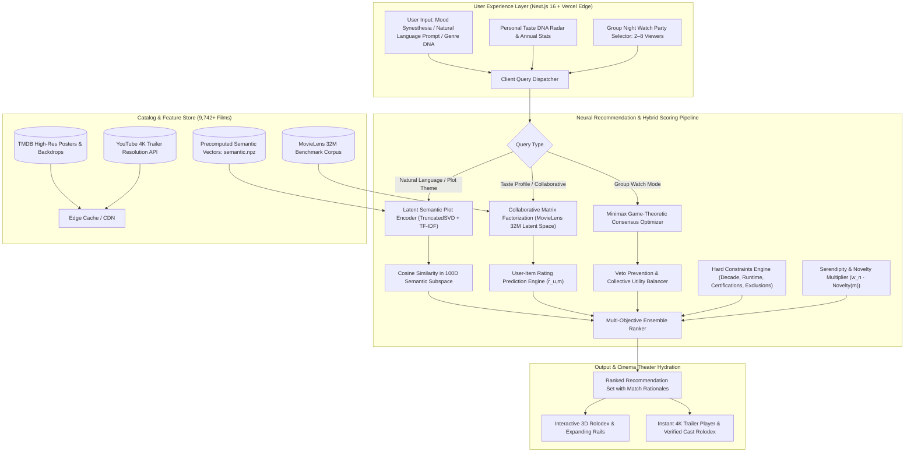

<div align="center">

<a href="https://cineverseai.vercel.app">
  
</a>

# 🎬 CINEVERSE AI
### The Intelligent Cinematic Universe & Neural Recommendation Engine

[](https://cineverseai.vercel.app)
[](https://nextjs.org/)
[](https://fastapi.tiangolo.com/)
[](https://www.typescriptlang.org/)
[](https://www.python.org/)
[](https://grouplens.org/datasets/movielens/)
[](https://www.docker.com/)
[](LICENSE)

<p align="center">
  <b>Tired of endless streaming fatigue and commercial algorithmic echo chambers?</b><br>
  Cineverse combines <b>Latent Semantic NLP</b>, <b>Collaborative Matrix Factorization</b>, <b>Minimax Group Consensus</b>, and <b>Cinematic Motion Design</b> into a state-of-the-art discovery universe.
</p>

### 🌐 [**Experience Live Demo on Vercel: cineverseai.vercel.app**](https://cineverseai.vercel.app)

[🌐 Live App](https://cineverseai.vercel.app) • [✨ Key Features](#-key-features) • [🔄 System Workflow](#-system-workflow--architecture) • [💡 Novelty & Innovation](#-novelty--competitive-advantage) • [🧠 ML Engine](#-neural--hybrid-recommendation-engine) • [🚀 Quickstart](#-quickstart) • [📡 API Reference](#-api-endpoints)

---

</div>

## 🌟 Why Cineverse?

Mainstream streaming platforms have a fundamental conflict of interest: **their algorithms optimize for ad impressions, watch-time retention, and studio licensing contracts—not your genuine taste.**

**Cineverse AI** restores algorithmic agency to the cinephile:
- 🌐 **Instant Live Access**: Deployed globally on [Vercel](https://cineverseai.vercel.app) with lightning-fast edge performance.
- 🎯 **Algorithmic Agency**: Fine-tune recommendations with real-time mood spectrum sliders, genre DNA weightings, and novelty controls.
- ⚡ **Zero-Tracking Privacy**: Run entirely in an open local or edge sandbox—no surveillance cookies, ad pixels, or paywalled subscriptions.
- 👥 **Group Night Consensus**: Solves the "what should we watch?" argument for 2–8 people using mathematical game-theoretic minimax fairness.
- 💎 **Hidden Gems Radar**: Surfaces critically acclaimed world cinema and indie masterworks that mainstream algorithms bury.

---

## 📸 Visual Showcase

<div align="center">
  <a href="https://cineverseai.vercel.app/discover">
    
  </a>
  <p><i><b>Real Discovery Interface</b>: 19-genre Neural Taste DNA analytics, instant mood synesthesia buttons, natural language theme search, and live movie catalog.</i></p>
</div>

<br>

<div align="center">
  <a href="https://cineverseai.vercel.app/discover">
    
  </a>
  <p><i><b>Real Cinema Theater & Spec Explorer</b>: High-res movie detail modal featuring Community Ratings, Metascore, 96% Taste Sync, official YouTube trailer playback, interactive cast & crew credits, and behind-the-scenes trivia.</i></p>
</div>

---

## 🔄 System Workflow & Architecture

Cineverse operates as an end-to-end, multi-stage recommendation and streaming intelligence pipeline. The diagram below illustrates how raw user input evolves into verified cinematic recommendations:



### Detailed Execution Flow:
1. **Intent Capture**: The viewer enters a natural-language description (e.g., *"existential deep-space psychological paradox"*), taps a mood trigger (*Mind-bending*, *Adrenaline*, *Melancholic*), or adjusts their 19-genre Taste DNA.
2. **Dual-Path Latent Encoding**:
   - The **Semantic Plot Encoder** projects the query into a 100-dimensional continuous vector space trained on 9,687+ enriched movie plots via TruncatedSVD and TF-IDF.
   - The **Collaborative Factorizer** projects user interaction vectors against latent movie factors derived from MovieLens matrix decomposition.
3. **Multi-Objective Hybrid Ranking**: The candidate pool is scored using a multi-factor objective function balancing semantic relevance, predicted taste affinity, genre alignment, and serendipity.
4. **Group Minimax Fairness (Optional)**: If in *Group Night* mode, the engine evaluates candidates across all attendees and optimizes for the film that minimizes individual viewer dissatisfaction ($\max \min_{u \in U} \text{utility}(u, m)$).
5. **Edge Hydration & Playback**: Results are enriched with verified TMDB artwork, verified actor/director filmographies, and instant YouTube trailer feeds.

---

## 💡 Novelty & Competitive Advantage

| Feature Dimension | Legacy Platforms (Netflix, Prime, Hulu) | Aggregators (IMDb, Letterboxd) | **Cineverse AI** |
|:---|:---|:---|:---|
| **Recommendation Engine** | Opaque commercial engagement optimizer (pushes high-margin originals) | Static popularity charts & unweighted star averages | **Multi-objective hybrid (Latent Semantic + SVD + Taste DNA)** |
| **Search Paradigm** | Rigid keyword & exact-title matching | Exact title, cast, and basic genre tags | **Poetic natural language & emotional mood synesthesia** |
| **Group Decision Making** | None (manual arguing & scrolling fatigue) | Shared watchlists without consensus algorithms | **Game-theoretic Minimax fairness consensus solver** |
| **Algorithmic Transparency** | Black box; no explanation provided | Basic user reviews | **Full mathematical explainability breakdown for every film** |
| **Catalog Exploration** | Monolithic vertical grids & auto-playing ads | Flat text lists and database tables | **3D Rolodex Ring, Expanding Rails & Glassmorphic Theater** |
| **Data Privacy** | Heavy behavioral tracking, profiling & data brokerage | Cookie tracking & commercial ad networks | **Zero tracking pixels; edge-cached or local sandbox execution** |

### Core Innovations in Cineverse:

#### 1. 🧠 Latent Semantic Subspace Projection
Unlike legacy search engines that break when a user queries non-keyword phrases like *"haunting feeling of being watched in an empty suburban winter"*, Cineverse's latent semantic encoder maps queries directly into continuous latent concept vectors, uncovering films based on atmosphere, philosophical undertones, and plot pacing.

#### 2. 🎛️ Real-Time 6-Axis Mood Synesthesia
Users can bias their discovery trajectory dynamically using 6 psychological spectrum vectors: *Mind-Bending*, *Melancholic*, *Adrenaline*, *Uplifting*, *Heartwarming*, and *Visceral*. The weighting vectors dynamically scale latent subspace coordinates without requiring slow database re-indexing.

#### 3. 👥 Game-Theoretic Minimax Group Watch Solver
Streaming fatigue peaks when couples or groups debate what to watch. Cineverse formulates group selection as a **minimax fairness optimization problem**:
$$\max_{m \in M} \left[ \min_{u \in U} \text{Utility}(u, m) \right] + \lambda \sum_{u \in U} \text{Utility}(u, m)$$
This mathematically prevents any single attendee from having a miserable experience, eliminating veto stalemates.

#### 4. 💎 Serendipity & Anti-Echo-Chamber Weighting
Algorithms optimized purely for collaborative filtering trap users in homogenous recommendation bubbles (recommending only the top 10 mainstream blockbusters). Cineverse introduces an explicit **Novelty Multiplier** ($w_n \cdot \text{Novelty}(m)$) that surfaces high-quality hidden gems and world cinema based on rating-to-popularity divergence.

#### 5. 🛡️ Local-First & Zero-Surveillance Architecture
Cineverse is architected to run seamlessly both as a global edge application on [Vercel](https://cineverseai.vercel.app) and as a local offline Docker sandbox. Your personal taste data, watch journal, and mood history remain under your direct control.

---

## ✨ Key Features

### 🌌 1. Ultra-Modern Cinematic Interface
- **GSAP Choreographed Entrances**: Silky-smooth sequence animations upon arrival.
- **Glassmorphic Navigation Bar**: Responsive backdrop blur with integrated search and quick portals.
- **Interactive 3D Rolodex Ring**: Dynamic rotating movie carousel with smooth perspective shifts.
- **Expanding Universe Rails**: Fluid genre dimension cards that expand on hover with particle aura effects.
- **Framer Motion Micro-Interactions**: Physics-based modals, smooth transitions, and tactile hover feedback.

### 🧬 2. Hybrid Neural & Semantic Discovery
- **Natural Language Query Engine**: Search by abstract themes like *"mind-bending sci-fi thrillers with existential dread"* or *"cozy rainy autumn mysteries"*.
- **6 Mood Spectrum Sliders**: Dynamically bias recommendations along *Mind-Bending*, *Melancholic*, *Adrenaline*, *Uplifting*, *Heartwarming*, and *Visceral*.
- **Personal Taste DNA**: Live radar visualization mapping your categorical affinities across 19 genres.
- **Taste Lab Fusion**: Select any 2 or 3 movies and compute their algorithmic hybrid lovechild.

### 🍿 3. Instant 4K Trailer Theater & Cast Explorer
- **Zero-Friction Trailers**: Instant YouTube trailer lookup and seamless modal theater player.
- **Cast & Crew Orbit**: Interactive filmography exploration with actor avatars and cross-movie credits.
- **Deep Film Specs**: Real-time MovieLens community ratings, release decades, runtimes, and TMDB plot summaries.

### 👥 4. Group Night Consensus Solver
- Pick 2 to 8 group members.
- Input each person's favorite films or preferences.
- Cineverse executes a **minimax fairness optimization** that maximizes collective happiness while minimizing individual disappointment.

### 💎 5. Hidden Gems & Mystery Reveal
- **Hidden Gems Scanner**: Filters for high rating-to-vote ratios to discover indie and world cinema jewels.
- **Mystery Pick**: Interactive blind-pick game with a cinematic reveal animation for indecisive movie nights.
- **Watch Journal**: Complete personal history, bookmarks, watchlist, and "Not for me" dismissals.

---

## 🧠 Neural & Hybrid Recommendation Engine

Cineverse combines collaborative filtering, latent semantic indexing, and content-based heuristics into an ensemble scoring pipeline:

$$\text{FinalScore}(m) = w_s \cdot \text{Sim}_{\text{Semantic}}(q, m) + w_c \cdot \hat{r}_{u,m} + w_g \cdot \text{TasteOverlap}(u, m) + w_n \cdot \text{Novelty}(m)$$

- **Matrix Factorization**: Trained on MovieLens (100k+ ratings in demo mode, scalable to MovieLens 32M).
- **Semantic Latent Space**: 9,687+ enriched movie plots projected into compact vector space (`data/semantic.npz` and `data/vocabulary.json`).
- **Explainability**: Every recommendation includes transparent rationale (e.g., *"Matches your Sci-Fi preference"*, *"Because you liked Inception"*, *"High community consensus"*).

---

## 🚀 Quickstart

### 🌐 Live Deployment
No installation needed! Visit the live production build:  
👉 **[https://cineverseai.vercel.app](https://cineverseai.vercel.app)**

---

### Option A: Standard Local Run (Zero External Setup Required)

**Prerequisites**: Node.js 22+, Python 3.12+

#### 1. Start the FastAPI Engine
```bash
# Clone the repository
git clone https://github.com/codexanjan/cineverse.git
cd cineverse

# Create virtual environment
python -m venv .venv

# Activate environment
# On macOS/Linux:
source .venv/bin/activate
# On Windows PowerShell:
.venv\Scripts\Activate.ps1

# Install backend dependencies
pip install -r apps/api/requirements.txt

# Run migrations and start API
cd apps/api
alembic upgrade head
uvicorn app.main:app --host 127.0.0.1 --port 8000 --reload
```

#### 2. Start the Cinematic Next.js Web App
In a second terminal window from the repository root:
```bash
# Install frontend packages
npm install

# Start development server
npm run dev
```

Visit **[http://localhost:3000](http://localhost:3000)** in your browser!  
Interactive API Swagger Docs are available at **[http://localhost:8000/docs](http://localhost:8000/docs)**.

---

### Option B: Docker Compose (One Command)

```bash
# Copy sample configuration (clean defaults included)
cp .env.example .env

# Launch Next.js, FastAPI, PostgreSQL (pgvector), Redis & background worker
docker compose up --build -d
```

- Web Interface: `http://localhost:3000`
- API & Docs: `http://localhost:8000/docs`
- Background Worker: Auto-syncs and manages hydration queues.

---

## 📁 Repository Structure

```
cineverse/
├── apps/
│   ├── web/                    # Next.js 16 (App Router, Turbopack, Framer Motion, GSAP)
│   │   ├── app/                # Pages: Discover, Categories, About, Profile, Auth
│   │   ├── components/         # Cinematic UI: Modals, Rolodex, Rails, Navbar
│   │   ├── lib/                # Catalog, Stream, Cast, and Sound APIs
│   │   └── data/               # Actors, Trailers, and Local Catalog Cache
│   └── api/                    # FastAPI Backend Recommender Service
│       ├── app/                # Main router, Recommender, Catalog, Auth, DB
│       ├── migrations/         # Alembic DB migrations
│       └── tests/              # Flow tests and benchmark suite
├── assets/                     # High-res real UI screenshots, Hero banner, and showcase media
├── data/                       # MovieLens dataset, pre-trained model weights (.npz)
│   ├── catalog.json            # 9,742 movies with TMDB metadata
│   ├── model.npz               # Trained collaborative latent factors
│   ├── semantic.npz            # Trained semantic plot embeddings
│   └── vocabulary.json         # Vocabulary dictionary for plot indexing
├── ml/                         # Training pipelines (MovieLens 32M, SVD, Semantic)
├── compose.yaml                # Multi-service Docker Compose configuration
├── vercel.json                 # Vercel deployment configuration
└── package.json                # Workspace monorepo root
```

---

## 📡 API Endpoints

| Method | Endpoint | Description |
|:---|:---|:---|
| `GET` | `/health` | Service health status and catalog item counts |
| `GET` | `/movies` | Paginated movie catalog with filtering & sorting |
| `GET` | `/movies/{id}` | Detailed movie record with plot, artwork & metrics |
| `POST` | `/discover` | Natural language semantic discovery & mood ranking |
| `POST` | `/group` | Group night consensus recommendation solver |
| `GET` | `/categories` | 19 catalog genres with film counts and cover art |
| `GET` | `/me/profile` | Current user profile, taste DNA, and preferences |
| `POST` | `/me/profile` | Update user preferences, avatars, and genre weights |
| `POST` | `/me/movies/{id}` | Update watched, favorites, and watchlist status |
| `GET` | `/api/trailer` | Real-time trailer resolution |
| `GET` | `/api/cast/photo` | Cast & crew metadata with high-res headshots |

---

## 🛠️ Tech Stack & Credits

- **Frontend & Deployment**: [Next.js 16](https://nextjs.org/), [Vercel](https://vercel.com/), [React 19](https://react.dev/), [TypeScript](https://www.typescriptlang.org/), [Tailwind CSS](https://tailwindcss.com/), [GSAP](https://gsap.com/), [Framer Motion](https://motion.dev/), [Lucide Icons](https://lucide.dev/)
- **Backend & ML**: [FastAPI](https://fastapi.tiangolo.com/), [NumPy](https://numpy.org/), [SciPy](https://scipy.org/), [Scikit-learn](https://scikit-learn.org/), [SQLAlchemy](https://www.sqlalchemy.org/), [Alembic](https://alembic.sqlalchemy.org/)
- **Storage & Infrastructure**: [PostgreSQL 16](https://www.postgresql.org/) with [pgvector](https://github.com/pgvector/pgvector), [Redis 7](https://redis.io/), [Docker](https://www.docker.com/), [Caddy](https://caddyserver.com/)
- **Datasets**: [GroupLens MovieLens](https://grouplens.org/datasets/movielens/), [The Movie Database (TMDB)](https://www.themoviedb.org/)

---

## 🤝 Contributing

Contributions are what make the open-source community an incredible place to learn, inspire, and create!

1. Fork the Project
2. Create your Feature Branch (`git checkout -b feature/AmazingFeature`)
3. Commit your Changes (`git commit -m 'feat: Add some AmazingFeature'`)
4. Push to the Branch (`git push origin feature/AmazingFeature`)
5. Open a Pull Request

---

## 📄 License

Distributed under the **MIT License**. See `LICENSE` for more information.  
MovieLens data is subject to the [GroupLens License Terms](data/MOVIELENS-LICENSE.txt).

---

<div align="center">
  <sub>Built with ❤️ for cinephiles and developers worldwide. Experience Cineverse live at <a href="https://cineverseai.vercel.app"><b>cineverseai.vercel.app</b></a>!</sub>
</div>
